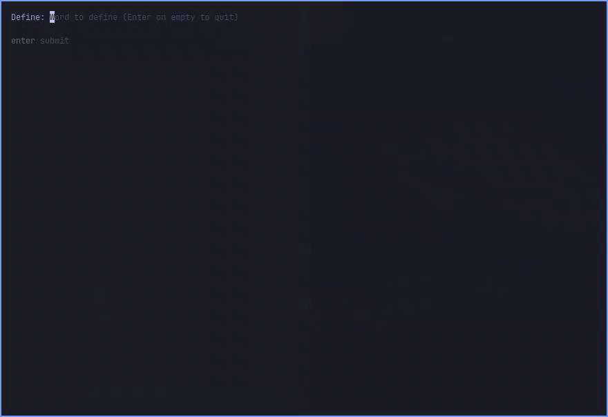

# omarchy-dict

A dictionary on a keystroke for [Omarchy](https://omarchy.org/), or any Arch
install running Hyprland. Press **Super + Alt + D**, type a word in any
language and read what it means, in a floating terminal.



There's nothing to choose up front. Each lookup searches the web for every
language that has the word, and then offers to install those languages, so
the next lookup works offline and shows definitions in the word's own
language:

|                    | Not installed                     | Installed                                          |
| ------------------ | --------------------------------- | -------------------------------------------------- |
| English            | Webster's 1913, WordNet and Moby thesaurus from dict.org | the same, with Webster's offline   |
| Any other language | English meanings from Wiktionary  | that language's Wiktionary, offline                 |
| Translations       | —                                 | between every pair of installed languages (FreeDict) |

The other languages are Bulgarian, Catalan, Chinese, Czech, Danish, Dutch,
Esperanto, Finnish, French, German, Greek, Italian, Japanese, Korean, Latin,
Lithuanian, Norwegian, Polish, Portuguese, Romanian, Russian, Spanish, Swedish,
Thai, Turkish and Ukrainian: everything [reader.dict](https://www.reader-dict.com)
publishes for DICT servers. Not every pair has a FreeDict translation.

Once a word is in a language you've installed, only your languages are shown
in full, and the rest are listed as "Also in: …". Installed dictionaries are
served by your own `dictd`, so adding one never asks for a password.

## Install

```bash
git clone https://github.com/julitrows/omarchy-dict.git ~/code/omarchy-dict
cd ~/code/omarchy-dict
./install.sh
```

The installer:

- installs `dictd`, `wl-clipboard` (to read the selection), `gum` and
  `libnotify`, and `dict-gcide` from the AUR for offline English
- links `systemd/omarchy-dict.service`, a user-level `dictd` for your
  dictionaries, into `~/.config/systemd/user` and enables it
- moves dictionaries an earlier version installed system-wide into
  `~/.local/share/omarchy-dict`
- links `bin/define` to `~/.local/bin/define`
- links the Claude Code skill into `~/.claude/skills`, if you use Claude Code
- appends a `dofile(...)` line to `~/.config/hypr/hyprland.lua` that loads
  `hypr/dictionary.lua`

To install languages straight away, pass their codes from `lib/languages`:
`./install.sh --languages=en,es,fr`.

Outside Omarchy it uses `pacman`, plus `yay` or `paru` for the AUR, and
installs `xdg-terminal-exec` to open your default terminal. Hyprland must use
the Lua config (`~/.config/hypr/hyprland.lua`), as Omarchy and current Hyprland
do. On Omarchy the popup follows your theme; elsewhere it's your default
terminal, floated and centred.

The repo stays the source of truth, so edits here take effect after a
`hyprctl reload`. Don't move the repo after installing; if you do, run
`./uninstall.sh` and `./install.sh` again.

## Usage

- **Super + Alt + D** opens the prompt. Type a word and press Enter, then `q`
  to get back to the prompt. Press Enter on an empty prompt to close it.
- **Super + Alt + W** looks up the text you've selected, and `q` closes it.
  Select a word by highlighting it; it doesn't need to be copied. With nothing
  selected, it opens the prompt.
- After a lookup, the popup offers to install the languages it showed that you
  don't have. Pick them with `x` and press Enter; they install in the
  background, with a notification when they're ready. Languages you don't pick
  aren't offered again, and Esc asks next time instead.
- **Managing languages**: type `:languages` at the prompt, or run
  `define --languages`, to add, remove or update languages, or to have
  declined ones offered again. Dictionaries live in
  `~/.local/share/omarchy-dict`.
- From any terminal: `define serendipity`, `define --es ñandú` to search one
  language, or `define --selection` for the selected text.

Lookups send the word to Wikimedia and dict.org. Without a network, only
installed languages work.

## Claude Code

- **For users:** `skills/omarchy-dict` is a skill that lets Claude look words
  up with `define`, and fix or rebind the popup. `install.sh` links it into
  `~/.claude/skills` when `~/.claude` exists.
- **For contributors:** `CLAUDE.md` explains how the project works and the
  pitfalls it has already hit. Under `.claude/`, the `test-define` skill runs
  the end-to-end checks, `add-language` walks through adding a language, and
  the `reviewer` agent reviews changes before a commit.

## Changing the keys

Edit the `bind(...)` lines at the end of `hypr/dictionary.lua`. On Omarchy,
check that a key is free with `omarchy menu keybindings --print`, or call
`hl.unbind("<keys>")` before the binding to replace an Omarchy default.

## Uninstall

```bash
./uninstall.sh
```

This removes the link, the keybindings, the dictionary server, every
downloaded dictionary and your language choices, and prints the command to
remove the packages too.

## Credits

Definitions in languages other than English come from
[Wiktionary](https://www.wiktionary.org/) (CC BY-SA): English meanings through
its API, and each language's own Wiktionary packaged by
[reader.dict](https://www.reader-dict.com). Translations come from
[FreeDict](https://freedict.org/). They're downloaded when you look words up
or install a language, and aren't part of this repo.
