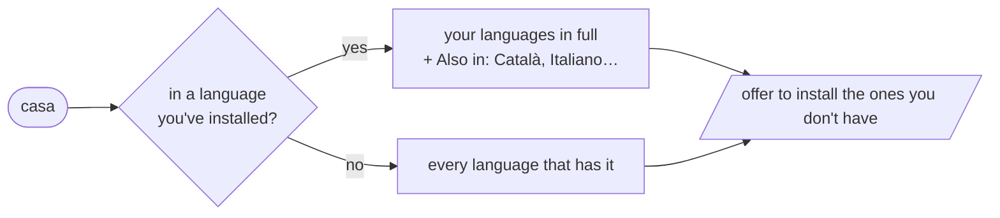

# hyprdefine

Look words up in any language from a floating popup on
[Hyprland](https://hypr.land), themed to match on [Omarchy](https://omarchy.org/).
Press **Super + Alt + D**, type a word, and read what it means.


There's nothing to set up per language. Each lookup finds every language that
has the word, then offers to install those languages so the next lookup works
offline and explains the word in its own language:

|                   | Before you install it                              | After                                              |
| ----------------- | -------------------------------------------------- | -------------------------------------------------- |
| English           | Webster's 1913, WordNet and Moby thesaurus, online | the same, with Webster's offline                   |
| 25 more languages | short English meanings from Wiktionary             | that language's own Wiktionary, offline            |
| Translations      | —                                                  | between every pair of installed languages (FreeDict) |

The other languages are Bulgarian, Catalan, Chinese, Czech, Danish, Dutch,
Esperanto, Finnish, French, German, Greek, Italian, Japanese, Korean, Latin,
Lithuanian, Norwegian, Polish, Portuguese, Romanian, Russian, Spanish, Swedish,
Thai, Turkish and Ukrainian.



## Install

From the AUR:

```bash
yay -S hyprdefine        # or paru, or omarchy pkg aur add hyprdefine
hyprdefine --setup       # as your user: adds the keys and the dictionary server
```

Or from a git checkout, which installs the dependencies and runs `--setup` for
you:

```bash
git clone https://github.com/julitrows/hyprdefine.git ~/code/hyprdefine
cd ~/code/hyprdefine
./install.sh
```

hyprdefine needs Hyprland's Lua config (`~/.config/hypr/hyprland.lua`), which
Omarchy and current Hyprland use. On Omarchy the popup uses your theme's
terminal; elsewhere it's your default terminal, floated and centred.

## Use it

| | |
| --- | --- |
| **Super + Alt + D** | Open the prompt. Type a word, press Enter, and `q` to come back. Enter on an empty prompt closes it. |
| **Super + Alt + W** | Look up the selected text. Highlighting is enough; no need to copy. `q` closes it. |
| `hyprdefine casa` | Look a word up from any terminal. `define casa` does the same. |
| `hyprdefine --es casa` | Look in one language only, by code. |

After a lookup, the popup offers to install languages it showed that you don't
have. Pick them with `x` and press Enter: they download and build in the
background, and a notification says when they're ready. Languages you don't
pick aren't offered again; Esc leaves the question for next time.

### Managing languages

Run `hyprdefine --languages`, or type `:languages` at the prompt, to add,
remove or update languages, or to have declined ones offered again. From a
script:

```bash
hyprdefine --install fr de    # codes from lib/hyprdefine/languages
hyprdefine --remove de
hyprdefine --update           # rebuild from the latest Wiktionary releases
```

None of this needs `sudo`: dictionaries live in `~/.local/share/hyprdefine`
and are served by your own `dictd` (`hyprdefine.service`). Each language takes
a minute or two to build. English uses Webster's from the `dict-gcide`
package when it's installed.

### Changing the keys

Copy `share/hyprdefine/hyprland.lua` (or `/usr/share/hyprdefine/hyprland.lua`)
somewhere of your own, change the `bind(...)` lines at the end, and point the
`-- hyprdefine` line in `~/.config/hypr/hyprland.lua` at your copy. On Omarchy,
`omarchy menu keybindings --print` shows which keys are free.

## Privacy

Lookups send the word to Wikimedia (Wiktionary) and dict.org, except for
databases you've installed. Without a network, only installed languages work.

## Troubleshooting

- **Nothing happens on the key**: run `hyprdefine --setup` again, then
  `hyprctl configerrors`.
- **Installed languages aren't used**: `systemctl --user status hyprdefine`
  should be active, and `dict -h localhost -p 2629 -D` should list them.
- **A language didn't install**: see `~/.local/share/hyprdefine/install.log`.

## Uninstall

```bash
hyprdefine --teardown     # as your user: keys, server, dictionaries, `define`
yay -R hyprdefine         # or ./uninstall.sh from a git checkout
```

## Development

```bash
make check    # syntax
make test     # the test suite: offline, about 30 seconds
```

[docs/architecture.md](docs/architecture.md) explains how it all fits
together, with diagrams, and [docs/packaging.md](docs/packaging.md) how the
AUR package is built and published. `CLAUDE.md` covers the same ground for
Claude Code, along with the pitfalls this project has already hit.

## Credits

Definitions come from [Wiktionary](https://www.wiktionary.org/) (CC BY-SA),
through English Wiktionary's API and each language's own Wiktionary as
packaged by [reader.dict](https://www.reader-dict.com); translations from
[FreeDict](https://freedict.org/); English from
[GCIDE](https://gcide.gnu.org.ua/), [WordNet](https://wordnet.princeton.edu/)
and the Moby thesaurus through [dict.org](https://dict.org). They're
downloaded as you use them and aren't part of this repo.

hyprdefine was called omarchy-dict until it stopped needing Omarchy.
`hyprdefine --setup` moves an omarchy-dict install over.
