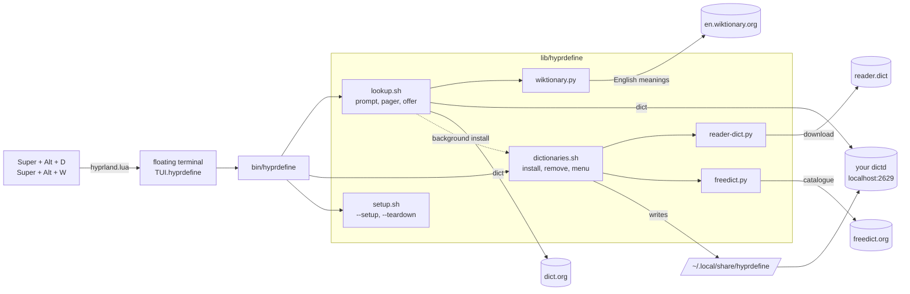
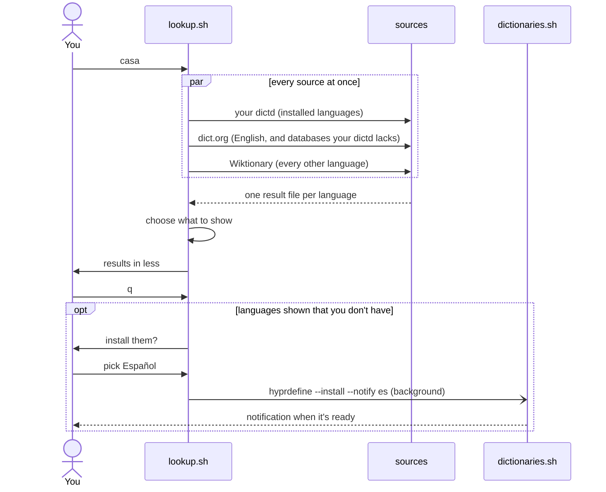
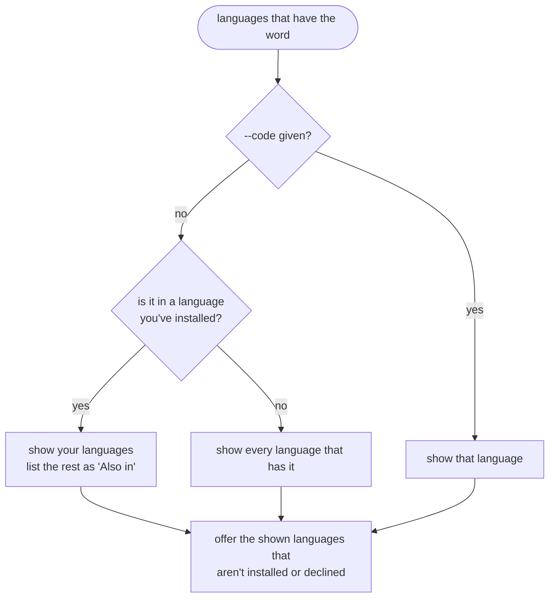
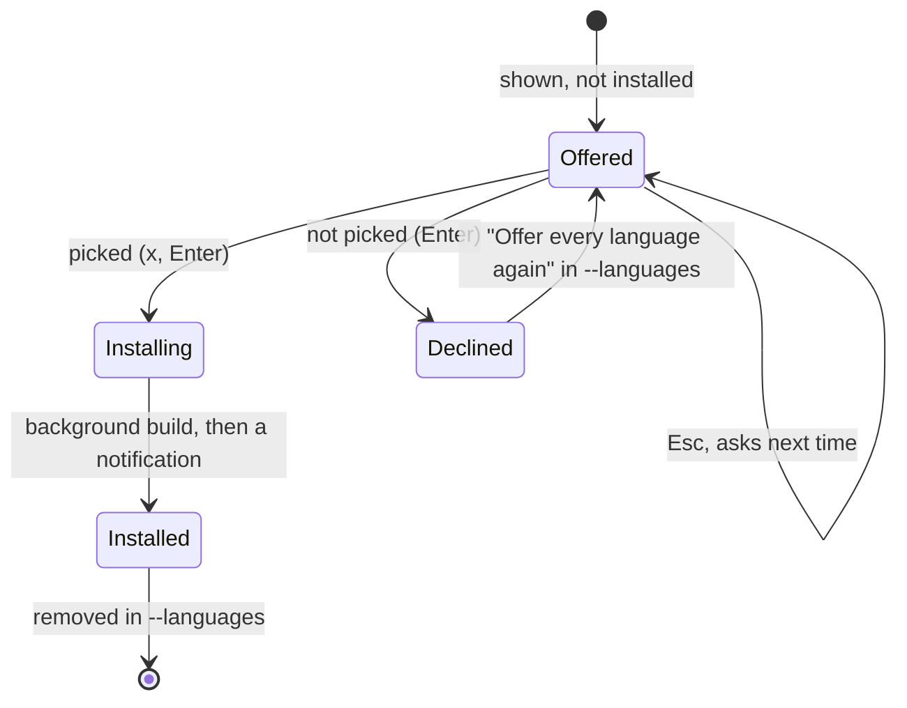

# How hyprdefine works

This is the tour for anyone changing hyprdefine: what runs when you press the
key, where every file lives, and why things are the way they are.

## The pieces

- **`bin/hyprdefine`** is the only executable. It works out where the rest
  lives from its own real path, so the same file runs from a git checkout,
  through `~/.local/bin` links, and from `/usr/bin` when packaged. It sources
  `common.sh` and then the file for the job: `lookup.sh` for lookups,
  `dictionaries.sh` for language changes, `setup.sh` for setup.
- **Your `dictd`** (`hyprdefine.service`) is a per-user dictionary server on
  127.0.0.1:2629, serving what's in `~/.local/share/hyprdefine`. Being per
  user is what lets installing a language skip `sudo`.
- **dict.org** has English (GCIDE, WordNet, Moby thesaurus) and the FreeDict
  translations, for whatever isn't installed.
- **English Wiktionary's definition API** answers "which languages have this
  word?" in one request, with English meanings for each. Other Wiktionaries
  have no such API, which is why definitions in a word's own language need
  the reader.dict download.

## A lookup

`lookup.sh` splits a lookup into `gather`, `choose` and `render`.

### Gather: local first, then dict.org

Each installed language contributes `"local remote"` database pairs: its own
dictionary (`es-es`), and translations to every other installed language
(`spa-eng`, or `fd-spa-eng` on dict.org). English is always queried, as GCIDE,
WordNet and Moby.

dict.org is only asked when your server can't answer:

| `dict` exit status | Meaning | Ask dict.org? |
| --- | --- | --- |
| 0 | found | no |
| 20, 21 | not in that database | no: a miss is an answer |
| 39 | no such database locally | yes |
| 41 | no server (nothing installed yet) | yes |

All queries run in parallel; each writes a numbered file, so the output keeps
a stable order.

When an installed language has no entry for the word, hyprdefine asks the
local server for headwords that are the same word with other marks (a `re`
match such as `^[tťţț][rř][oó…]p[eé…][lł][ií…][aá…]$`) and searches up to
three of them the same way, translations included. So `tropelia` finds
`tropelía`. This only runs on a miss and only against your own server, so it
costs nothing on a hit and never sends anything to dict.org.

### Choose: what's shown in full

English only counts through GCIDE and WordNet. English Wiktionary's own entry
for a word those lack is nearly always a name ("Haus: a surname"), which would
otherwise hide the language the word really belongs to.

### The install offer

After the pager closes in the popup, hyprdefine offers the languages it showed
that you don't have. The answer is remembered in `~/.config/hyprdefine`:

## Installing a language

`hyprdefine --install es` (from the offer, the menu or the command line):

1. Downloads reader.dict's DICT.org file for the language and rebuilds it
   with `reader-dict.py` and `dictfmt`. The download can't be used as is: its
   index isn't sorted the way `dictd` searches, and each entry is one line of
   HTML, which `dictd` cuts off.
2. Downloads the FreeDict translations between the new language and every
   installed one, from freedict.org's catalogue, checking each against the
   catalogue's SHA-512. A pair FreeDict doesn't have is skipped; a few
   languages have none.
3. Writes `dictd.conf` and restarts `hyprdefine.service`, or stops it when
   nothing is left, because `dictd` won't start without a database.

Language changes take a lock, so a background install and the menu never run
at once. English has no download; installing it serves GCIDE from the
`dict-gcide` package when that's installed.

## Where things live

| Path | What |
| --- | --- |
| `~/.config/hyprdefine/languages` | installed language codes |
| `~/.config/hyprdefine/declined` | languages not to offer again |
| `~/.local/share/hyprdefine/dictionaries/` | `<code>-<code>` and `<from>-<to>` dictionaries |
| `~/.local/share/hyprdefine/dictd.conf` | written by `--install` and `--remove` |
| `~/.local/share/hyprdefine/install.log` | output of background installs |
| `~/.config/hypr/hyprland.lua` | one line ending in `-- hyprdefine`, added by `--setup` |
| `~/.local/bin/define` | the short name, linked by `--setup` |

The repo mirrors the installed layout, so `make install` is a plain copy:

| Repo | Installed |
| --- | --- |
| `bin/hyprdefine` | `/usr/bin/hyprdefine` |
| `lib/hyprdefine/` | `/usr/lib/hyprdefine/` |
| `lib/systemd/user/hyprdefine.service` | `/usr/lib/systemd/user/` |
| `share/hyprdefine/hyprland.lua` | `/usr/share/hyprdefine/` |
| `share/hyprdefine/skill/` | `/usr/share/hyprdefine/skill/` |

## Setup

A package can't touch your home directory, so `hyprdefine --setup` does the
per-user part, and `--teardown` undoes it:

- links the systemd unit into `~/.config/systemd/user` (git checkouts only;
  the package installs it system-wide) and enables it
- adds `loadfile("…/hyprland.lua")("…/hyprdefine") -- hyprdefine` to
  `~/.config/hypr/hyprland.lua`, passing the path so the keys run the same
  hyprdefine that set them up
- links `define` and the Claude Code skill, but never over a file that isn't
  hyprdefine's
- moves an install from hyprdefine's earlier name, omarchy-dict

`hyprland.lua` uses Omarchy's `o.bind` and `o.window` helpers when they exist,
for Omarchy's themed terminal and floating rules, and plain `hl.bind` with
`xdg-terminal-exec` otherwise.

## Tests

`make test` runs everything offline in a scratch home: a fake `dict` answers
from fixtures and logs every query, a local web server stands in for
Wiktionary, reader.dict and FreeDict, and `systemctl`, `notify-send` and
`hyprctl` are recorded rather than run. `dictfmt` and `dictzip` run for real.

| File | Covers |
| --- | --- |
| `test_lookup.py` | which sources are asked, what's shown, "Also in", fallbacks, accents |
| `test_dictionaries.py` | installing, removing, checksums, notifications, the server |
| `test_setup.py` | setup, teardown, idempotency, migration from omarchy-dict |
| `test_popup.py` | the prompt loop, pager, `--selection` and install offer, in a pty |
| `test_hyprland_lua.py` | the bindings, with Omarchy and without |
| `test_helpers.py` | the Python helpers and the language list |
